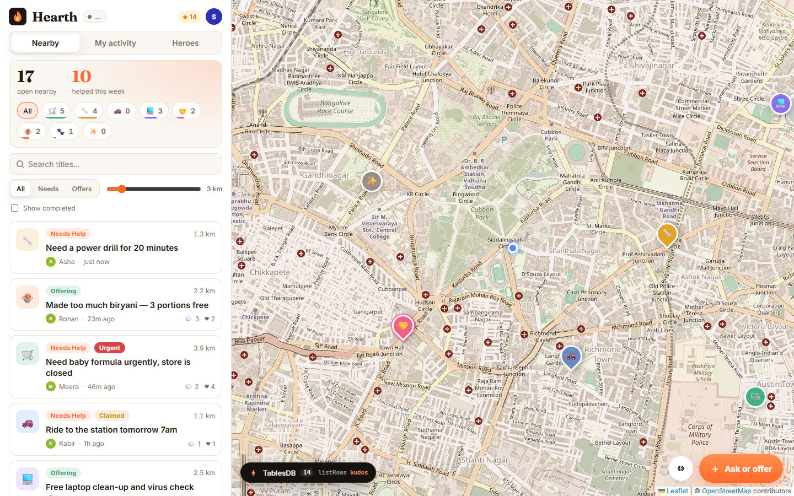
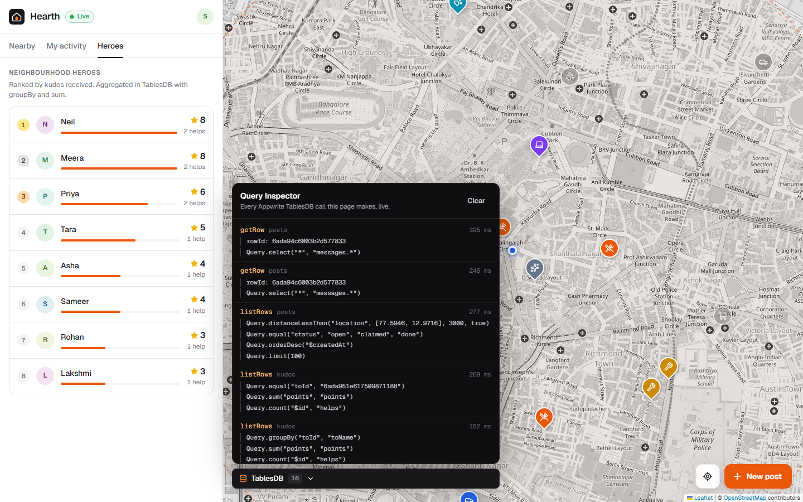
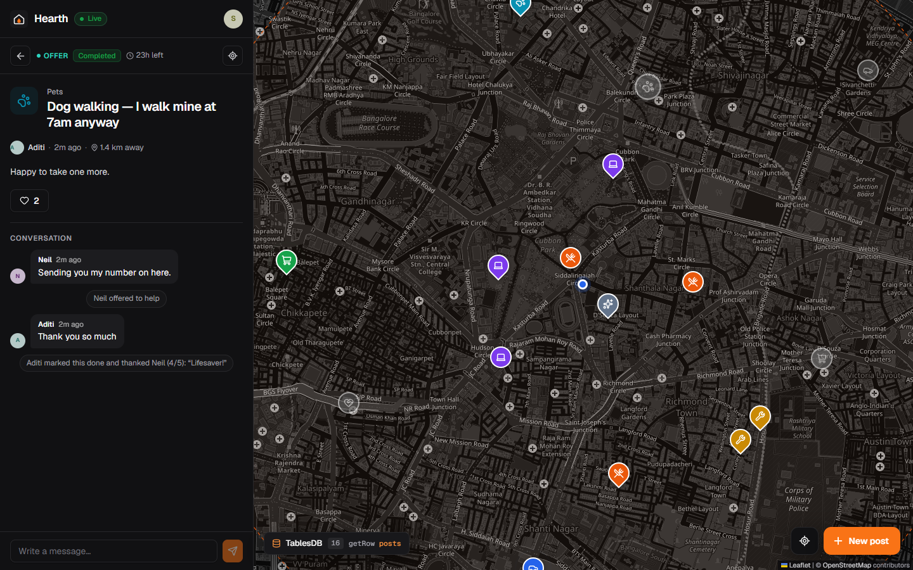

<p align="center"></p>

<h1 align="center">Hearth</h1>
<p align="center"><b>Your neighbourhood on a live map.</b><br/>Ask for a hand or lend one: a ladder, a ride, a meal, ten minutes of tech help.</p>
<p align="center"><a href="docs/Hearth-pitch-deck.pptx">Pitch deck (.pptx)</a></p>
<p align="center">Built solo for the <a href="https://hackathon.appwrite.io">Appwrite Databases Hackathon</a> (Oct 19–31, 2026) on <b>Appwrite TablesDB</b>.</p>

<p align="center"></p>

---

## Why Hearth

Most people would help a neighbour if they knew someone needed it. Most people needing help would rather not post in a 400-person WhatsApp group. Hearth sits right in between. You drop a pin with a small ask ("need a drill for 20 minutes") or an offer ("extra biryani, 3 portions"). Neighbours inside your radius see it appear live. One taps **I can help**, you chat, and when it's done you send them kudos. Kudos add up to a neighbourhood **Heroes** board.

No email, no feed algorithm, no followers. Just a first name and a map pin.

## What makes it interesting technically

Hearth is built to use as much of **Appwrite TablesDB** as a real product would, not just CRUD:

| TablesDB feature | Where Hearth uses it |
| --- | --- |
| **Point column + spatial index** | Every post has a `location` point. The feed is a `Query.distanceLessThan('location', center, meters, true)` radius search, computed by the database. |
| **Full-text index** | Title search uses `Query.search('title', …)` on a `fulltext` index. |
| **Enums, varchar, text, datetime, integer columns** | Typed schema for kind / category / status / urgency, plus expiry timestamps and counters with `min: 0`. |
| **Compound key index** | `status + $createdAt` backs the main "open posts, newest first" query. |
| **One-to-many relationships** | `posts → messages` (cascade delete, so a post never leaves an orphaned thread) and `posts → kudos` (set-null: kudos outlive a post). Threads load in a single call via `Query.select(['*', 'messages.*'])`. |
| **Transactions** | **Claiming** reads the post inside a transaction, stages the claim and a system message, then commits. If two neighbours tap *I can help* at the same moment, the second commit hits a conflict and nothing is applied, so the UI says "someone beat you to it". |
| **Batch operations (`createOperations`)** | **Completing** a post stages four writes across three tables (post → `done`, a kudos row, a thank-you message, a counter increment) and commits them atomically. |
| **Atomic counters & operators** | Hearts use `incrementRowColumn`; reply counts use `Operator.increment(1)` inside `updateRow`. No read-modify-write races. |
| **Aggregations** | The **Neighbourhood Pulse** is `groupBy(['category']) + count()` within the radius. **Heroes** is `groupBy(['toId','toName']) + sum('points') + count()`. Your karma is a filtered `sum`. Both fall back to a narrow `select` + client tally on servers without aggregation. |
| **Logical queries** | *My activity* is `Query.or([equal('authorId'), equal('helperId')])` on two indexed columns. |
| **Cheap counts** | "Helped this week" is `equal('status','done') + updatedAfter(7 days) + limit(1)`, which reads only `total`. |
| **Row security + permissions** | Anyone can read; signed-in users create/claim; only the author holds `delete` on their own post row, and only until a neighbour has replied. Other people's messages are never deletable by the author. |
| **Realtime** | One websocket subscribes to `tablesdb.hearth.tables.{posts,messages,kudos}.rows`. New pins drop onto the map, threads update, and the pulse/heroes refresh live. |

### 🔍 The Query Inspector

Click **⚡ TablesDB** in the corner of the map. Every database call the page makes (queries rendered as the SDK calls that built them, timings, transaction stages, rollbacks, and Realtime pushes) streams into a live panel. This is how you can verify the table above while using the app.

<p align="center"></p>

<p align="center"></p>

## Architecture

```
Browser (React + Leaflet)
  │  appwrite web SDK
  ├── Account ............ anonymous session + display name
  ├── TablesDB ........... listRows / getRow / createRow / updateRow /
  │                        incrementRowColumn / transactions / createOperations
  └── Realtime ........... rows channel for posts, messages, kudos
                               │
                      Appwrite Cloud · TablesDB "hearth"
                      ┌──────────────┐ 1   * ┌──────────────┐
                      │    posts     │──────▶│   messages   │  (cascade)
                      │ location:pt  │       └──────────────┘
                      │ status/kind… │ 1   * ┌──────────────┐
                      │ hearts/replies│─────▶│    kudos     │  (set null)
                      └──────────────┘       └──────────────┘
```

There is no custom backend. Everything is the Appwrite client SDK talking to TablesDB with permissions enforced by Appwrite. The server SDK is only used by the two provisioning scripts.

## Run it yourself

**Requirements:** Node 20.6+ (for `--env-file`) and an [Appwrite Cloud](https://cloud.appwrite.io) project.

1. **Create a project** in Appwrite Cloud. Under *Overview → Add platform → Web*, add `localhost` (and later your Sites domain).
2. **Create an API key** (*Overview → API keys*) with the `databases`, `tables`, `columns`, `indexes` and `rows` scopes. It is only used by the setup/seed scripts and never shipped to the browser.
3. **Configure:**
   ```bash
   cp .env.example .env    # fill in endpoint, project ID and API key
   npm install
   ```
4. **Create the schema** (idempotent, safe to re-run):
   ```bash
   npm run setup
   ```
5. **Verify** every TablesDB feature against your project (spatial, full-text, relationships, aggregations, transactions incl. a forced conflict, batch ops, cascade):
   ```bash
   npm run smoke
   ```
6. **Seed a neighbourhood** around `VITE_DEFAULT_LAT/LNG`:
   ```bash
   npm run seed                  # ~45 posts with threads, claims and kudos
   npm run seed -- --live-only   # optional: a new neighbour posts every few seconds
   npm run seed -- --reset       # wipe and reseed
   ```
7. **Start:**
   ```bash
   npm run dev
   ```

Make sure *Auth → Settings → Anonymous* is enabled (it is by default).

### Deploy on Appwrite Sites

*Sites → Create site → Import from GitHub*, select this repo, then set:

| Setting | Value |
| --- | --- |
| Framework | Vite (React) |
| Install command | `npm install` |
| Build command | `npm run build` |
| Output directory | `dist` |
| Env vars | `VITE_APPWRITE_ENDPOINT`, `VITE_APPWRITE_PROJECT_ID`, `VITE_APPWRITE_DATABASE_ID`, `VITE_DEFAULT_LAT`, `VITE_DEFAULT_LNG` |

Then add the Sites domain as a Web platform in the project.

## Tech stack

All open source:

- [Appwrite](https://appwrite.io): TablesDB, Realtime and Auth via [`appwrite`](https://www.npmjs.com/package/appwrite) (web) and [`node-appwrite`](https://www.npmjs.com/package/node-appwrite) (scripts)
- [React 19](https://react.dev) + [Vite](https://vite.dev) + TypeScript
- [Leaflet](https://leafletjs.com) + [react-leaflet](https://react-leaflet.js.org) with [OpenStreetMap](https://www.openstreetmap.org) tiles (no API key), themed for light/dark with CSS filters
- [Lucide](https://lucide.dev) icons
- Fonts: [Geist and Geist Mono](https://vercel.com/font)

No AI APIs and no paid map APIs.

## Project layout

```
scripts/setup.mjs     schema: tables, columns, relationships, indexes
scripts/seed.mjs      demo neighbourhood + live activity simulator
src/lib/api.ts        every TablesDB query, transaction and aggregate
src/lib/inspector.ts  call log behind the Query Inspector
src/hooks/            session (anonymous auth) and Realtime subscription
src/components/       map, feed, drawer, compose sheet, heroes, inspector
```

## License

MIT
